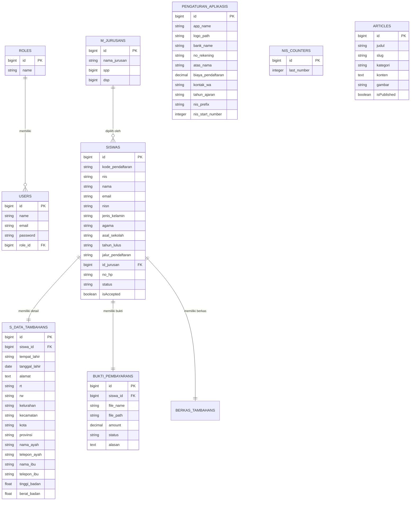
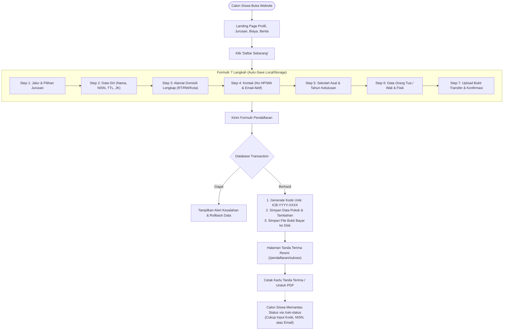
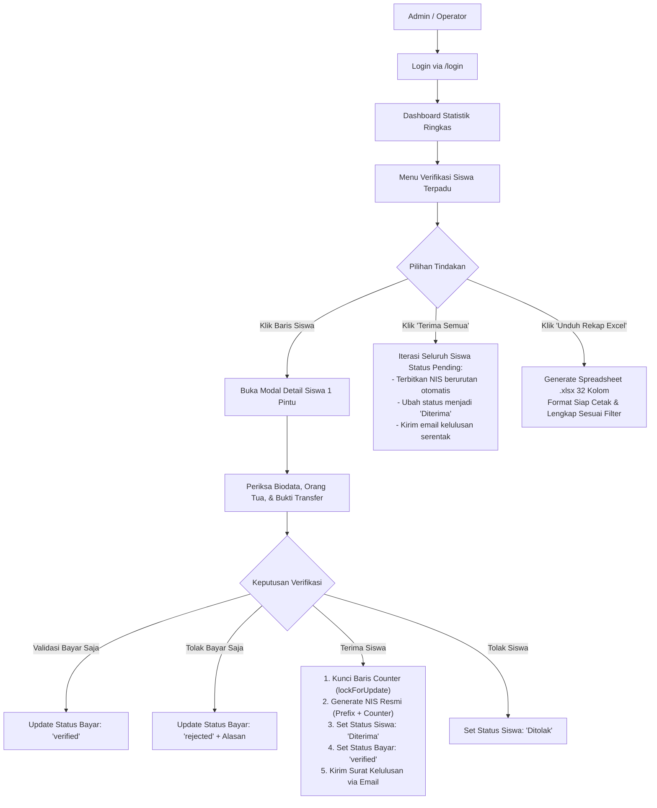

# DOKUMENTASI & ANALISIS LENGKAP SISTEM SPMB / PPDB ONLINE
**Aplikasi: Sistem Penerimaan Murid Baru (SPMB) SMK ICB Cinta Teknika Bandung**  
**Tech Stack:** Laravel 11.x | PHP 8.2+ | MySQL | AdminLTE 3 / Bootstrap | Select2 | DataTables | PhpSpreadsheet

---

## 1. Ringkasan Eksekutif & Karakteristik Sistem

Aplikasi ini adalah platform digital terintegrasi untuk menangani seluruh rangkaian Penerimaan Peserta Didik Baru (PPDB / SPMB), mulai dari penjaringan calon siswa melalui landing page publik, pengisian formulir pendaftaran interaktif 7 langkah, unggah bukti bayar instan, pengecekan status mandiri, hingga verifikasi terpusat satu pintu oleh panitia dengan penerbitan Nomor Induk Siswa (NIS) otomatis serta notifikasi kelulusan via email.

### Keunggulan Arsitektur Utama:
1. **Model Single-Stream (Tanpa Beban Login Siswa):**  
   Calon siswa tidak diwajibkan mendaftar akun atau mengingat password portal. Pendaftaran dilakukan langsung, diverifikasi dengan kode unik, dan status dapat dipantau hanya dengan memasukkan Kode Pendaftaran, NISN, atau Email.
2. **Formulir 7 Langkah dengan Auto-Save Draft (LocalStorage):**  
   Pendaftar tidak perlu khawatir kehilangan data saat browser ter-refresh atau koneksi terputus. Sistem secara cerdas menyimpan draft di peramban dan memulihkannya secara otomatis.
3. **Verifikasi Satu Pintu (Single-Modal Review):**  
   Panitia dapat meninjau biodata lengkap siswa, data orang tua, sekolah asal, dan foto bukti transfer dalam satu modal, lalu memvalidasi pembayaran dan menerbitkan NIS secara instan.
4. **Penerbitan NIS Otomatis & Atomic (Anti-Race Condition):**  
   Menggunakan penguncian baris basis data (`lockForUpdate()`) agar tidak terjadi duplikasi atau lompatan nomor NIS meskipun banyak panitia melakukan verifikasi bersamaan.
5. **Ekspor Rekapitulasi Excel Profesional (.xlsx):**  
   Mendukung ekspor data 32 kolom lengkap dengan styling resmi, zebra-striping, pewarnaan badge status, dan freeze pane untuk kebutuhan administrasi sekolah dan Dinas Pendidikan.

---

## 2. Struktur Entitas Basis Data (Entity Relationship Diagram)

---

## 3. Diagram Alur Kerja Sistem (Workflows)

### A. Alur Calon Siswa (Public User Flow)

### B. Alur Panitia & Administrator (Admin Flow)

---

## 4. Bedah Fungsionalitas Modul & Kode

### 1. Pendaftaran Publik (`SiswaController.php`)
* **Endpoint:** `GET /siswa/register`, `POST /siswa/register`
* **Fitur Utama:**
  * Validasi komprehensif (keberadaan ID jurusan, keunikan email siswa, ukuran file bukti maksimal 10MB).
  * Pembuatan kode registrasi sekuensial tahunan: `ICB-{TAHUN}-{0001}`.
  * Penyimpanan file upload ke direktori terisolasi: `storage/app/public/pendaftar/{nama_siswa}/bukti_bayar/`.
* **Cek Status Mandiri (`cekStatusPost`):**
  * Pencarian fleksibel multi-kriteria: `WHERE kode_pendaftaran = ? OR nisn = ? OR email = ?`.
  * Menampilkan badge kelulusan, nomor NIS (jika sudah diterima), dan keabsahan pembayaran beserta catatan penolakan jika bukti tidak terbaca.

### 2. Panel Verifikasi Terpadu (`VerifikasiSiswaController.php`)
* **Endpoint:** `/admin/verifsiswa`
* **Fitur Utama:**
  * **Mesin Penomoran NIS Atomic (`generateNIS`):**
    Mengambil format prefix (misal: `125`) dan nomor awal dari tabel pengaturan. Menggunakan `DB::table('nis_counters')->lockForUpdate()` untuk menjamin nomor urut tidak pernah bentrok atau kembar. Mendukung input *Custom NIS* manual bila diperlukan.
  * **Verifikasi Cepat 1 Pintu:** Admin dapat menyetujui, menolak, memvalidasi bukti bayar, atau menolak bayar langsung dari satu modal tampilan.
  * **Penerimaan Massal (`approveAll`):** Mengakomodasi kebutuhan panitia saat rapat pleno kelulusan: memproses puluhan/ratusan siswa pending menjadi diterima hanya dalam sekali klik.
  * **Ekspor Excel Tingkat Mahir (`exportXlsx`):** Menggunakan PhpSpreadsheet untuk menyusun dokumen rekapitulasi 32 kolom lengkap dengan kop surat sekolah, pewarnaan otomatis baris, styling status (hijau/kuning/merah), dan freeze pane.

### 3. Pengaturan Sistem Dinamis (`PengaturanAplikasiController.php`)
* **Endpoint:** `/admin/settings`
* Mengendalikan identitas sekolah, upload logo, konfigurasi nomor rekening bank dan biaya formulir, nomor WhatsApp bantuan panitia, tahun ajaran aktif, serta parameter generator NIS.
* Dilengkapi sistem cache memory (`Cache::rememberForever`) untuk memastikan query pengaturan tidak memperlambat respon web.

### 4. Surat Keputusan Elektronik (`PengumumanKelulusanMail.php`)
* Mengirimkan email surat ketetapan kelulusan formal berformat HTML responsif kepada calon siswa begitu status diubah menjadi `Diterima`.
* Memuat kop surat digital, ucapan selamat resmi, NIS resmi yang diterbitkan, jurusan yang diterima, dan panduan langkah daftar ulang berikutnya.

### 5. CMS Berita & Artikel (`ArticleController.php`)
* **Endpoint:** `/admin/articles`
* Mengelola publikasi artikel, tata cara pendaftaran, dan informasi beasiswa di halaman landing page publik.
* Dilengkapi pembuatan URL ramah SEO (*slug generator* otomatis), upload gambar unggulan, dan editor konten.

---

## 5. Ringkasan Keunggulan untuk Yayasan & Sekolah Mitra

Sistem ini memiliki sifat **Multi-Tenant Ready** atau sangat mudah diadaptasi untuk unit sekolah lain di bawah naungan yayasan yang sama (seperti SMK ICB Cinta Niaga dan SMK ICB Cinta Wisata). Seluruh parameter biaya, rekening tujuan, jurusan, logo, format nomor induk, dan narasi pengumuman bersifat dinamis 100% dari panel admin tanpa perlu mengubah kode sumber inti.

